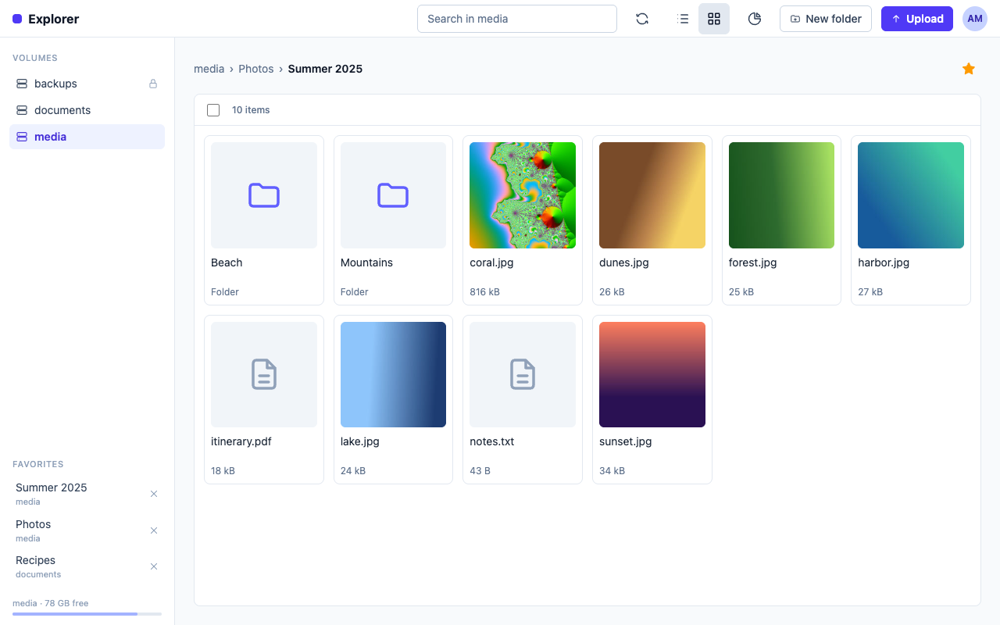

# Explorer

Self-hosted web file manager written in Rust (Axum server, Dioxus web UI).

Explorer lets the people of a household browse and manage the folders of a home NAS from a
browser: you mount folders into the container, sign in through your OIDC provider, and use
them from any computer or phone.



## Features

- **Sign-in** through an OIDC provider (tested with [PocketID](https://pocket-id.org)),
  restricted to one group. Tokens stay on the server.
- **Browse** every mounted volume, in a sortable list or a grid with image thumbnails;
  favorite folders; search by name.
- **Download** files (resumable) and folders or selections as zip.
- **Upload** files and folders, by button or drag and drop, in resumable chunks that survive
  a dropped connection or a reload; a name already taken offers Replace, Keep both or Cancel.
- **Manage** files: new folder, rename, and delete, copy and move, also between volumes, as
  background tasks with progress and cancellation.
- **Space usage**: see what takes the room in a folder.
- Read-only volumes, dark mode, phone-sized screens, English, French and Spanish.

## Quick start

You need Docker, an OIDC provider such as [PocketID](https://pocket-id.org) and a reverse
proxy terminating TLS. The image is `ghcr.io/rust-explorer/explorer:1.0.0` (`linux/amd64`).

```sh
mkdir -p -m 700 explorer/config && cd explorer
curl -fsSLo docker-compose.yml https://raw.githubusercontent.com/rust-explorer/explorer/main/docker-compose.example.yml
curl -fsSLo .env https://raw.githubusercontent.com/rust-explorer/explorer/main/.env.example
# edit .env and docker-compose.yml, then:
docker compose up -d
```

See [docs/installation.md](docs/installation.md) for the full setup (OIDC client, UID/GID,
volumes, reverse proxy) and [docs/configuration.md](docs/configuration.md) for every
variable. Changes between versions are listed in [CHANGELOG.md](CHANGELOG.md).

## License

Source-available under the [PolyForm Noncommercial License 1.0.0](LICENSE). This is not OSI open source: commercial use is not permitted.

## Documentation

- [Installation](docs/installation.md)
- [Configuration](docs/configuration.md)
- [Architecture](docs/architecture.md)
- [Security](docs/security.md)
- [Development](docs/development.md)

Design and plans live in [`docs/`](docs/).
